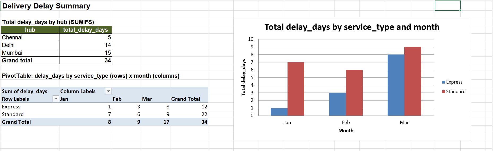

# Delivery Delay Analysis

| | |
|---|---|
| **Project title** | Delivery Delay Analysis |
| **Student name** | Priya Shihora |
| **Student ID** | 12814 |
| **Assigned set** | Set A |

---

## 1. Business objective and business questions

**Objective:** find out where and when deliveries run late, so that the operations team can decide which service type, route and hub to fix first.

Each row in the data is a month-end route/hub delivery summary (Jan–Mar). The analysis answers two business questions:

1. **Which service type (Express or Standard) causes more delay, and how often are deliveries late?**
2. **Which route and hub account for the largest share of the total delay, and is the delay getting worse month by month?**

---

## 2. Project folder structure

```
Delivery-Delay-Analysis/
├── README.md
│
├── excel/
│   ├── analysis.xlsx                  Raw, Lookup, Clean, Summary sheets
│   ├── deliveries.csv                 original fact file (13 rows)
│   └── Delivery-Deley-Summary.png     screenshot of the Summary sheet
│
├── sql/
│   ├── setup.sql                      run FIRST  (creates DB, tables, loads data)
│   └── queries.sql                    run SECOND (S2a, S2b, S2c, S3 check)
│
└── python-work/
    ├── data/
    │   └── raw/
    │       ├── deliveries.csv         fact file (13 rows incl. 1 duplicate)
    │       └── routes.csv             lookup file (4 rows)
    ├── outputs/
    │   ├── clean_data.csv             clean merged data (12 rows)
    │   ├── python_summary.csv         service-type summary
    │   └── python_chart.png           monthly delay chart
    └── python/
        └── analysis.ipynb             pandas + matplotlib notebook
```

---

## 3. Excel summary (screenshot)



*Summary sheet: hub totals (SUMIFS), PivotTable (service_type × month) and the column chart built from it.*

---

## 4. Dataset and data dictionary

**Files:** `deliveries.csv` (fact file, 13 rows including 1 exact duplicate, 12 unique) and `routes.csv` (lookup file, 4 rows).
`route_id` is the lookup key: one `routes` row maps to many `deliveries` rows.

### deliveries.csv

| Column | Type | Meaning |
|---|---|---|
| `record_id` | integer | Unique record number (1–12) |
| `month` | text (ordered: Jan → Feb → Mar) | Month-end the summary belongs to |
| `route_id` | text | Route code (R1–R4); foreign key to `routes.route_id` |
| `hub` | text | Hub handling the deliveries (Chennai, Delhi, Mumbai) |
| `promised_days` | numeric | Delivery time promised, in days |
| `actual_days` | numeric | Delivery time actually taken, in days |

### routes.csv

| Column | Type | Meaning |
|---|---|---|
| `route_id` | text | Route code (primary key) |
| `route` | text | Route name (Metro Link, City Dash, Highway Freight, Rural Feeder) |
| `service_type` | text | Express or Standard |

### Derived fields

| Column | Type | Meaning |
|---|---|---|
| `service_type` (in Clean / merged data) | text | Pulled from `routes` by `route_id` |
| `delay_days` | numeric | Days late; 0 if on time or early |
| `is_delayed` (Python only) | boolean | `actual_days > promised_days` |

---

## 5. Data cleaning steps and metric definitions

### Cleaning steps
1. Load `deliveries.csv` (13 rows) and `routes.csv` (4 rows).
2. Set data types: `record_id` integer, `promised_days` and `actual_days` numeric, `month`, `route_id`, `hub` text.
3. Remove the one **exact duplicate row** (record 12, Mar, R4, Mumbai, 6, 15 appears twice): **13 rows → 12 rows**.
4. Join with `routes` on `route_id` (left join) to add `route` and `service_type`.
5. Check the join: exactly 12 rows and **0 unmatched** `route_id` (no blank `service_type`).
6. Add `delay_days`.

### Metric definitions

| Metric | Definition |
|---|---|
| **delay_days** | `MAX(actual_days − promised_days, 0)`. Python: `(actual_days − promised_days).clip(lower=0)`. SQL: `GREATEST(actual_days − promised_days, 0)` |
| **Delay incidence rate** | `records where actual_days > promised_days ÷ all records × 100`, shown as a percentage. Calculated from counts, never by averaging subgroup percentages |

> Summed `delay_days` is **cumulative record-level delay**, not the number of unique parcels to expedite today.

---

## 6. Tools and versions used

| Tool | Version / note |
|---|---|
| Microsoft Excel | Microsoft 365 desktop (formulas: SUMIFS, INDEX/MATCH, MAX; PivotTable; column chart) |
| SQL engine | **MySQL 8.0** syntax (`sql/` scripts also test-run on MariaDB 10.11, MySQL-compatible) |
| Python | 3.13 |
| pandas | 3.0.5 |
| matplotlib | 3.11.2 |
| Jupyter | IPython kernel (ipykernel 7.4), Jupyter Notebook / JupyterLab |
| Power BI | Power BI Desktop (latest) for the dashboard |

To read the versions on your own machine:
`python --version`, `pip show pandas matplotlib`, `mysql --version`.

---

## 7. SQL: setup and query execution steps

Run the files **in this order**: `setup.sql` first, then `queries.sql`.

**Command line** (from the project root):

```bash
mysql -u root -p < sql/setup.sql
mysql -u root -p < sql/queries.sql
```

**MySQL Workbench:** open `sql/setup.sql` → run all (lightning icon) → open `sql/queries.sql` → run all.

What each file does:

| File | Purpose |
|---|---|
| `setup.sql` | Drops and recreates database `delivery_db`. Creates `routes` (PK `route_id`) and `deliveries` (PK `record_id`, FK `route_id` → `routes.route_id`). Inserts 4 lookup rows and 12 fact rows (duplicate excluded). Ends with a row-count check. |
| `queries.sql` | **S2a** total delay_days by service type · **S2b** routes with summed delay_days > 8 (`GROUP BY` + `HAVING`) · **S2c** top two hubs by delay_days (ties broken by hub A→Z) · **S3** `LEFT JOIN` integrity check (unmatched keys) |

Expected results:

| Query | Result |
|---|---|
| Row counts after setup | deliveries 12, routes 4 |
| S2a | Standard 22, Express 12 |
| S2b | R4 Rural Feeder 14, R1 Metro Link 9 (R3 = 8 is not > 8) |
| S2c | Mumbai 15, Delhi 14 |
| S3 | total_fact_rows 12, unmatched_keys 0 |

---

## 8. Python: environment setup and run instructions

1. Install Python 3.10 or newer, then install the packages:

   ```bash
   pip install pandas matplotlib jupyter
   ```

2. Open a terminal in the `python-work/` folder and start Jupyter:

   ```bash
   cd python-work
   jupyter notebook
   ```

3. Open `python/analysis.ipynb` and choose **Kernel → Restart & Run All** (run the cells top to bottom, cell order matters).

4. Optional, run without opening the browser:

   ```bash
   jupyter nbconvert --to notebook --execute --inplace python/analysis.ipynb
   ```

All paths are relative to `python-work/` (the notebook finds this folder itself), so no path edits are needed on another machine.
Outputs written: `outputs/clean_data.csv`, `outputs/python_summary.csv`, `outputs/python_chart.png`.

---

## 9. Excel sheet guide (`excel/analysis.xlsx`)

| Sheet | What it does |
|---|---|
| **Raw** | Original 13-row `deliveries.csv`, unchanged (includes the duplicate). Shows the row count. |
| **Lookup** | The 4-row `routes.csv` lookup table. |
| **Clean** | 12 unique rows. `service_type` column uses `INDEX/MATCH` on the Lookup sheet. `delay_days` column uses `=MAX(actual_days−promised_days,0)`. Before/after row counts (13 → 12) are shown beside the table. |
| **Summary** | Hub totals with `SUMIFS` (Chennai 5, Delhi 14, Mumbai 15), PivotTable of `delay_days` by `service_type` (rows) × `month` (columns, Jan → Feb → Mar), and a column chart with title, axis labels and legend. |

If you change data in **Clean**, right-click the PivotTable → **Refresh**. Formulas stay live (nothing is hard-coded).

---

## 10. Findings and recommendation

**Finding 1: Standard service causes most of the delay.** Standard routes carry **22 of 34 total delay_days (64.71%)** against 12 for Express (35.29%). The delay incidence rate is also higher for Standard: **83.33% (5 of 6 records)** vs **66.67% (4 of 6)** for Express. Overall incidence is **75.00%** (9 of 12 records).

**Finding 2: One route and one month stand out.** Route **R4 (Rural Feeder)** has **14 delay_days, which is 41.18% of the total 34**. Delay also grows through the quarter: Jan 8, Feb 9, **Mar 17** (50.00% of the total). Mumbai (15) and Delhi (14) together hold 29 of the 34 delay_days.

**Recommendation:** start with the **Rural Feeder (R4) route**, especially at the Mumbai and Delhi hubs: review its capacity and set more realistic `promised_days`, then check whether the March jump (17 delay_days, driven by R4's 9-day delay and R1's 6-day delay) repeats in the next month. Standard service needs a service-level review before Express does.

*Note: delay_days is cumulative record-level delay, so these figures show where delay is concentrated, not how many unique parcels to expedite.*

---

## 11. Cross-tool reconciliation

**Aggregate checked: total delay_days across all 12 clean records = 34.**

| Tool | Where the value comes from | Value |
|---|---|---|
| Excel | `Summary` sheet: SUMIFS hub total (5 + 14 + 15) and PivotTable grand total | **34** |
| SQL (MySQL) | `queries.sql` S2a: Standard 22 + Express 12 | **34** |
| Python | `analysis.ipynb`: `df["delay_days"].sum()` (`total_delay`) | **34** |
| Power BI | Card visual: sum of `delay_days` (update this value if your visual shows something different) | **34** |

**Rounding notes:** `delay_days` are whole numbers, so the totals need no rounding and match exactly. Percentages (incidence rate, route share) are rounded to two decimals only for display: 83.33%, 66.67%, 75.00%, 41.18%.

---

## 12. Video

- **Video URL:** https://drive.google.com/drive/folders/1FLFycMdNVbne1EijtoPE7lcoD_odGF1B

---

## 13. References

- pandas documentation: https://pandas.pydata.org/docs/
- matplotlib documentation: https://matplotlib.org/stable/
- MySQL 8.0 Reference Manual (`GREATEST`, `GROUP BY`/`HAVING`, joins): https://dev.mysql.com/doc/refman/8.0/en/
- Microsoft Excel support (PivotTables, SUMIFS, INDEX/MATCH): https://support.microsoft.com/excel
- Microsoft Power BI documentation (data source settings): https://learn.microsoft.com/power-bi/
- Claude (Anthropic AI assistant) was used for help in drafting code and the README structure; I reviewed and ran all the work myself.

---

## 14. Authorship declaration

**All work in this repository is my own except where cited.**

Priya Shihora (ID: 12814), Set A
